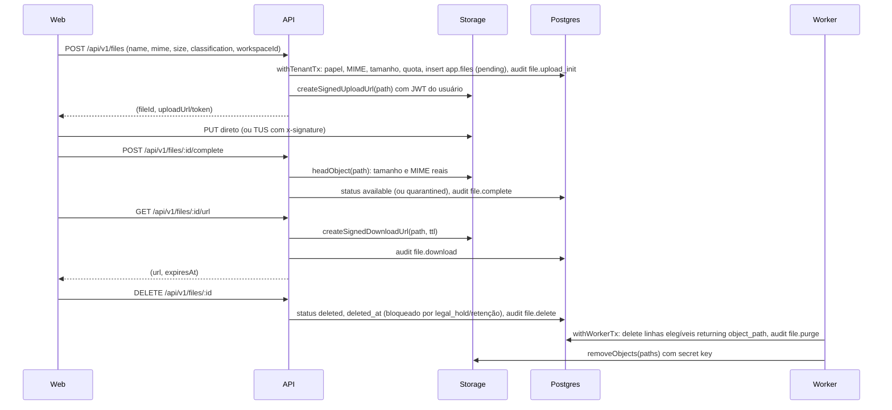

# Storage e governança de arquivos

> **Quando ler:** ao criar upload/download, mexer no módulo `files`, nas policies de `storage.objects`, no job de retenção, em quota por organização, ou ao atender pedido de eliminação (LGPD) que envolva arquivo.
> **Resumo:**
> - Um projeto Supabase por ambiente concentra dados (Postgres), identidade (Auth) e arquivos (Storage): RLS, auditoria, classificação e retenção num lugar só.
> - Metadados em `app.files` (Postgres, RLS como as demais); binário no bucket privado `private-files`. Nunca URL pública permanente de dado `confidential|personal`.
> - A API fala com o Storage com o **JWT do usuário** + chave *publishable* (policies valem). Secret key só no worker, só para purga e reconciliação.
> - Upload direto do cliente ao Storage por URL/token assinado; download por URL assinada de 60–300 s, sempre auditada.
> - Exclusão é soft delete; a remoção física é do worker, que respeita `legal_hold` e `retention_until` e grava `file.purge`.
> **Relacionados:** [arquitetura](01-arquitetura.md) (ADR-009), [banco](02-banco-de-dados.md), [segurança](03-seguranca.md), [backend](05-backend-api.md), [deploy](09-deploy-easypanel-supabase.md), [testes](07-testes.md), [lições](08-licoes-aprendidas.md)

Itens `[verificar]` não foram confirmados na documentação oficial do Supabase em 2026-10-30.

## Por que centralizar

- Um único dono de identidade (`auth.users`) para tabela e arquivo: a mesma membership que libera a linha libera o objeto. Sem segundo sistema de permissão para manter em sincronia.
- Governança (quem enviou, quem baixou, até quando guardar, o que está sob retenção legal) vive em SQL auditável, junto do `audit_log`.
- Cada ambiente tem **o seu** projeto Supabase: dev nunca aponta para o Storage de prod (padrão recorrente: teste contra dado real é o maior risco, ver [08](08-licoes-aprendidas.md)).
- Disco do container não é armazenamento: some no redeploy e não tem backup ([09](09-deploy-easypanel-supabase.md) §3).

## Modelo

DDL real: `supabase/migrations/<timestamp>_files_storage.sql`. Referência (resumo):

```sql
alter table app.organizations add column storage_quota_bytes bigint
  check (storage_quota_bytes is null or storage_quota_bytes >= 0);

create table app.files (
  id uuid primary key default gen_random_uuid(),
  organization_id uuid not null references app.organizations (id) on delete cascade,
  workspace_id uuid,
  bucket text not null default 'private-files',
  object_path text not null unique,
  original_name text not null check (char_length(original_name) between 1 and 255),
  mime_type text not null,
  size_bytes bigint not null check (size_bytes >= 1),
  sha256 text check (sha256 is null or sha256 ~ '^[0-9a-f]{64}$'),
  classification text not null default 'internal'
    check (classification in ('public', 'internal', 'confidential', 'personal')),
  status text not null default 'pending'
    check (status in ('pending', 'available', 'quarantined', 'deleted')),
  retention_until timestamptz,
  legal_hold boolean not null default false,
  uploaded_by uuid not null,
  created_at timestamptz not null default now(),
  updated_at timestamptz not null default now(),
  deleted_at timestamptz,
  foreign key (organization_id, workspace_id) references app.workspaces (organization_id, id) on delete cascade,
  check ((status = 'deleted') = (deleted_at is not null))
);
create index files_org_created_idx on app.files (organization_id, created_at desc);
create index files_workspace_idx on app.files (organization_id, workspace_id) where workspace_id is not null;
```

- **Caminho do objeto**: `<organization_id>/<workspace_id|org>/<file_id>/<nome-sanitizado>` (segmento 2 é o literal `org` para arquivo da organização). Gerado pelo servidor, uuids em minúsculas; o nome sanitizado não tem `/`, `..` nem caractere de controle. O nome original só fica na coluna.
- `object_path` nunca é reutilizado: nova versão = novo `file_id`. Sobrescrever objeto deixa cópia velha em cache de CDN (a doc do Supabase desaconselha upsert por isso).
- RLS de `app.files`: arquivo de workspace → membros daquele workspace; arquivo da organização → só `owner`/`admin`. Mesmo padrão de [02](02-banco-de-dados.md) §"RLS".
- Bucket `private-files` (privado, `file_size_limit` e `allowed_mime_types` na migration, via `insert into storage.buckets ... on conflict do update`). Opcional: `public-assets` só para logo/branding sem dado pessoal.

## Policies de `storage.objects` e o helper

O Storage avalia as policies como o papel `authenticated` do Supabase, a partir do JWT do usuário. Como o front também tem a chave *publishable* e o JWT, **qualquer usuário pode chamar o Storage direto, sem passar pela API**: as policies são a barreira real, não um detalhe. Por isso o helper confere o caminho **e** o estado do arquivo em `app.files`.

```sql
create or replace function app.can_access_object(p_name text, p_mode text) returns boolean
language plpgsql stable security definer set search_path = '' as $$
declare
  v_uid uuid := auth.uid();
  v_parts text[] := string_to_array(coalesce(p_name, ''), '/');
  v_roles text[] := case p_mode
    when 'read' then array['owner', 'admin', 'manager', 'staff', 'member']
    when 'write' then array['owner', 'admin', 'manager', 'staff']
    when 'delete' then array['owner', 'admin', 'manager'] end;
  f app.files%rowtype;
begin
  if v_uid is null or v_roles is null or array_length(v_parts, 1) <> 4 then return false; end if;
  select * into f from app.files where object_path = p_name and bucket = 'private-files';
  if not found or v_parts[1] <> f.organization_id::text
     or v_parts[2] <> coalesce(f.workspace_id::text, 'org') or v_parts[3] <> f.id::text then
    return false;
  end if;
  if not (case p_mode
      when 'read' then f.status = 'available' or (f.status = 'pending' and f.uploaded_by = v_uid)
      when 'write' then f.status = 'pending' and f.uploaded_by = v_uid
      else f.status = 'deleted' and not f.legal_hold
           and (f.retention_until is null or f.retention_until <= now()) end) then
    return false;
  end if;
  return exists (select 1 from app.memberships m
    where m.user_id = v_uid and m.organization_id = f.organization_id and m.status = 'active'
      and m.role = any (v_roles) and (m.workspace_id is null or m.workspace_id = f.workspace_id));
end $$;

revoke execute on function app.can_access_object(text, text) from public, anon;
grant usage on schema app to authenticated;
grant execute on function app.can_access_object(text, text) to authenticated;
revoke execute on function app.current_user_id(), app.current_org_id(), app.set_updated_at() from public, anon;

create policy private_files_select on storage.objects for select to authenticated
  using (bucket_id = 'private-files' and app.can_access_object(name, 'read'));
create policy private_files_insert on storage.objects for insert to authenticated
  with check (bucket_id = 'private-files' and app.can_access_object(name, 'write'));
create policy private_files_delete on storage.objects for delete to authenticated
  using (bucket_id = 'private-files' and app.can_access_object(name, 'delete'));
```

- Sem policy de UPDATE: sem upsert, nenhum objeto `available` (já conferido/escaneado) é trocado por outro conteúdo.
- `read` exige `available` (ou o próprio `pending` do uploader, para o `complete` conferir o objeto): arquivo `quarantined` não baixa nem por chamada direta.
- `delete` só vale para linha já `deleted`, sem `legal_hold` e com retenção vencida: legal hold é imposto também na camada do Storage.
- `auth.uid()` aqui é a única exceção à regra "policies usam `app.current_user_id()`" ([02](02-banco-de-dados.md) §"Funções helper"): no contexto do Storage quem chama é `authenticated`, que lê `auth`; o helper é `security definer` com `search_path = ''`.
- Papéis por modo espelham `files:read|write|delete` em `packages/shared/src/permissions.ts`; mudou um, mude o outro e o teste.
- Equivalente com `storage.foldername(name)` (array das pastas, `[1]` = organização) serve para checagens só de caminho; aqui o `string_to_array` também valida o nome do arquivo.

**Grants ao `authenticated` não contradizem "nunca conceder `authenticated` ao `app_api`".** A regra de [02](02-banco-de-dados.md) §"Papéis" proíbe `app_api` **herdar** tudo que `authenticated` tem. Aqui é o inverso e mínimo: o papel do Storage ganha `usage` no schema `app` e `execute` numa função que só devolve boolean. Nenhuma tabela de `app` tem grant para `authenticated`, a Data API está desligada (ADR-002) e o `execute` implícito de `PUBLIC` nos demais helpers é revogado. Um teste de catálogo prova isso (seção Testes).

## Fluxo ponta a ponta



1. **init** (`POST /api/v1/files`, `files:write`): Zod; MIME na allowlist `FILE_ALLOWED_MIME`; `size <= FILE_MAX_BYTES` (≤ limite do bucket); quota: `app.org_storage_used_bytes() + size <= storage_quota_bytes` (null = sem limite) — serialize por organização com `pg_advisory_xact_lock(hashtext(org_id))` para duas requisições paralelas não estourarem juntas. Commit **antes** de chamar o Storage (nada de rede dentro da transação, [05](05-backend-api.md)).
2. **upload**: o cliente envia direto ao Storage; a API não trafega o binário (sem `multer` para arquivo grande).
3. **complete** (`POST /api/v1/files/:id/complete`, só o uploader): confere existência, tamanho e MIME do objeto contra a linha; divergência → objeto rejeitado (`quarantined`). Magic bytes: ler os primeiros KB por Range na URL assinada e checar com `file-type` [verificar suporte a Range]. `sha256`, se o cliente informar, é conferido pelo worker ao baixar o objeto (antivírus/backup).
4. **url** (`GET /api/v1/files/:id/url`, `files:read`): só `available`; TTL `STORAGE_SIGNED_URL_TTL_SECONDS` (default 120, faixa 60–300); `download` = `Content-Disposition: attachment` para tipos que o navegador executaria (HTML, SVG). URL assinada não é revogável antes de expirar [verificar]: por isso é curta e nunca vai para log.
5. **delete** (`DELETE /api/v1/files/:id`, `files:delete`): soft delete; recusado (`FILE_LEGAL_HOLD` / `FILE_RETENTION_ACTIVE`) se `legal_hold` ou `retention_until > now()`. O objeto continua até a purga.

Código: `apps/api/src/modules/files/` (routes/service/repository), `integrations/storage-client.ts` (interface `StorageClient` injetável; fake em teste), `jobs/files-retention.ts` (purga e reconciliação).

## Uploads grandes, limites e custos

| Fato (Supabase Cloud) | Valor | Fonte |
|---|---|---|
| Limite global de arquivo | Free 50 MB; Pro/Team até 500 GB (configurável em Storage Settings); limite por bucket deve ser menor | doc "File limits" |
| Upload simples (padrão) | indicado até ~6 MB | doc "Standard uploads" |
| Resumable (TUS) | `https://<ref>.storage.supabase.co/storage/v1/upload/resumable`, chunk de 6 MB fixo, URL de upload válida por até 24 h | doc "Resumable uploads" |
| TUS com URL assinada | token de `createSignedUploadUrl` no header `x-signature` | doc "Resumable uploads" |
| Signed upload URL | válida por 2 h | referência JS `createSignedUploadUrl` |
| Permissão para assinar download | `createSignedUrl` exige SELECT em `storage.objects` | referência `createSignedUrl` |
| Upload exige | INSERT em `storage.objects`; upsert exige também SELECT e UPDATE | doc "Access control" |
| `remove` exige | DELETE (+ SELECT) em `storage.objects` | [verificar] |
| Assinar upload checa a policy de INSERT no momento da assinatura, não no PUT | — | [verificar] |
| Armazenamento incluído | Free 1 GB; Pro 100 GB, excedente ≈ US$ 0,0213/GB-mês | doc "Storage pricing" |
| Egress incluído/excedente | — | [verificar na página de preços] |
| Transformação de imagem | Pro+; 100 imagens de origem/ciclo, depois US$ 5 por 1.000; máx. 25 MB, 50 MP, 1–2500 px; funciona com `createSignedUrl({ transform })` | doc "Image transformations" |

- Regra: `FILE_MAX_BYTES` ≤ `file_size_limit` do bucket ≤ limite global do plano. Acima de ~6 MB o front usa TUS; abaixo, `uploadToSignedUrl`.
- Imagem que precisa de reencode (remover EXIF, [03](03-seguranca.md) §"HTML e uploads"): job no worker após o `complete`, gravando nova versão; transformação do Supabase redimensiona mas não substitui essa limpeza [verificar].

## CDN e cache: não expor dado sensível

- Bucket privado: cada acesso passa por autorização; o cache de borda é por usuário (doc "CDN fundamentals"). Bucket público é cacheado para qualquer um: só `public-assets`.
- Nunca `getPublicUrl` em `private-files`; nunca `classification in ('confidential','personal')` em bucket público.
- Objeto apagado pode ser servido do cache por algum tempo [verificar]; para dado sensível, prefira TTL curto da URL e `cache-control` baixo no upload.
- URL assinada não entra em log, `audit_log.metadata`, e-mail ou mensagem: lá vai o `file_id`; o destinatário pede URL nova.

## Credenciais

| Processo | Credencial no Storage | Efeito |
|---|---|---|
| web | publishable (`VITE_SUPABASE_ANON_KEY`) + JWT | só o que as policies deixam; normalmente só PUT no URL assinado |
| api | `SUPABASE_PUBLISHABLE_KEY` + `Authorization: Bearer <jwt do usuário>` | policies valem; nenhum bypass |
| worker | `SUPABASE_SECRET_KEY` | ignora RLS: só purga e reconciliação |
| backup (se adotado) | chaves S3 do Storage | ignoram RLS (doc "S3 authentication"); só no serviço de backup |

O worker com secret key decide pelo banco, não pelo Storage: primeiro `delete from app.files ... returning object_path` dentro de `withWorkerTx` (a policy `to app_worker` exige `legal_hold = false` e retenção vencida) + `audit_log` `file.purge` na mesma transação; depois do commit, `remove`. Falhou o `remove` → objeto órfão, a reconciliação apaga depois. Nunca o contrário (apagar o objeto e depois descobrir o legal hold).

## Governança

- **Classificação** (`classification`) definida no init pela regra do módulo, não pelo usuário final; `personal` = contém dado de titular (documento, comprovante). Inventário LGPD: [03](03-seguranca.md) §"LGPD".
- **Trilha** em `app.audit_log` (`entity_type = 'file'`): `file.upload_init`, `file.complete`, `file.download`, `file.delete`, `file.purge`, `file.quarantine`. `metadata` com `size_bytes`, `mime_type`, `classification`; nunca `original_name` (pode conter nome de pessoa) nem URL.
- **Retenção**: `retention_until` vem da regra do módulo (ex.: documento fiscal) — DECIDIR prazos com o jurídico. Antes do prazo a API recusa o delete.
- **Legal hold**: congela o arquivo (sem delete, sem purga). No scaffold não há endpoint: a API não tem grant de UPDATE em `legal_hold`/`retention_until`; alterar é operação manual auditada ou endpoint futuro só para `owner`, com ADR.
- **Eliminação LGPD (art. 18)**: localizar os arquivos do titular pelo vínculo do módulo → soft delete → purga pelo worker. Arquivo sob legal hold/retenção legal fica e a resposta ao titular explica a base legal [verificar com jurídico]. Backup externo precisa expirar no prazo documentado, senão a eliminação não se completa.
- **Quota**: `organizations.storage_quota_bytes` (null = sem limite); estouro → `STORAGE_QUOTA_EXCEEDED` no init. O plano do SaaS define o valor.
- **Reconciliação** (worker, diário): linhas `pending` > 24 h → apagar linha e objeto; objeto sem linha há > 24 h → remover; linha `available` sem objeto → alerta (não apagar sozinho).

`DECIDIR:` **antivírus.** (a) sem AV, só allowlist + magic bytes — aceitável se só staff interno envia PDF/imagem; (b) ClamAV em container próprio, o `complete` grava `quarantined` e o worker escaneia → `available` ou mantém em quarentena + alerta — recomendado assim que `member`/usuário externo enviar arquivo; (c) API externa de varredura: dado sai do ambiente, exige DPA. O modelo já tem `quarantined` para (b).

`DECIDIR:` **backup dos objetos.** Backups do banco (diário e PITR) **não incluem** objetos do Storage, e restaurar backup não traz de volta objeto apagado (doc "Database backups"); o S3 do Supabase não tem versionamento (doc "S3 compatibility"). Opções: (a) nada — só em dev; (b) serviço separado (ex.: `rclone` agendado no Easypanel) copiando `private-files` via protocolo S3 para bucket externo com versionamento e expiração (ex.: 30 dias), chaves S3 só nele — recomendado para prod; (c) cópia pelo próprio worker com secret key — mais código, mistura responsabilidades. Em qualquer opção: restore testado e prazo de expiração coerente com a eliminação LGPD.

## Testes obrigatórios

> **Estado dos testes:** o kit traz testes unitários (StorageClient simulado) e de SQL em PGlite com um stub do schema `storage`. **Nada foi validado contra um Supabase real**: a primeira tarefa de quem adotar o kit é escrever os testes de integração abaixo (`*.int.test.ts`) contra o projeto dev, antes de subir qualquer arquivo real; use [07](07-testes.md) para a infraestrutura (tenant de teste, trava de ambiente). Os endpoints REST do Storage usados em `storage-client.ts` estão `[verificar]`.

| Teste | Onde | Prova |
|---|---|---|
| Isolamento entre organizações no Storage | `*.int.test.ts` com dois tenants | usuário de A não assina nem lê objeto de B (`can_access_object` = false; API → 404) |
| Workspace | idem | `member` do workspace 1 não lê arquivo do 2 nem de `org` |
| URL expirada | unit + int | TTL respeitado (60–300); GET após expirar → erro do Storage |
| Legal hold | int | `DELETE` → `FILE_LEGAL_HOLD`; worker não purga; policy `delete` = false |
| Retenção | int | antes de `retention_until` não apaga; depois, purga e grava `file.purge` |
| MIME e tamanho | unit | MIME fora da allowlist → `FILE_TYPE_NOT_ALLOWED`; `size > FILE_MAX_BYTES` → 422 `FILE_TOO_LARGE`; quota estourada → `STORAGE_QUOTA_EXCEEDED`; `complete` com tamanho divergente → `quarantined` |
| Quarentena | int | `quarantined` não gera URL (API) nem lê direto (policy) |
| Catálogo de grants | SQL no CI | abaixo |

```sql
select p.proname from pg_proc p join pg_namespace n on n.oid = p.pronamespace
where n.nspname = 'app' and has_function_privilege('authenticated', p.oid, 'execute');
select table_name from information_schema.role_table_grants
where grantee = 'authenticated' and table_schema = 'app';
```

Esperado: só `can_access_object` na primeira; zero linhas na segunda. Simular o contexto do Storage no teste: `set local role authenticated; select set_config('request.jwt.claims', json_build_object('sub', $1, 'role', 'authenticated')::text, true);` e chamar o helper. Tenant de teste criado e apagado pelo teste ([07](07-testes.md)); objetos de teste removidos no `afterAll`.

## Checklist de go-live

- [ ] Bucket `private-files` criado pela migration no dev e no prod, `public = false`, limite e MIME conferidos no painel.
- [ ] Limite global do plano ≥ `file_size_limit` do bucket ≥ `FILE_MAX_BYTES`.
- [ ] Policies de `storage.objects` presentes (select/insert/delete, sem update) e teste de catálogo de grants verde.
- [ ] `SUPABASE_SECRET_KEY` só no worker; API e web sem secret (grep no Easypanel e no build).
- [ ] TTL de URL assinada ≤ 300 s; nenhuma URL assinada em log.
- [ ] Job `files-retention` rodando com advisory lock e logando contagens.
- [ ] DECIDIR antivírus e backup de objetos resolvidos para prod; restore de objeto testado.
- [ ] Prazos de retenção por tipo de arquivo definidos com o jurídico.
